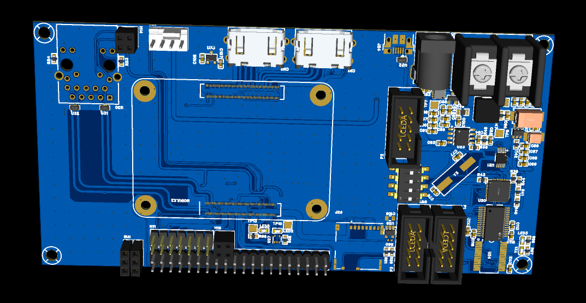
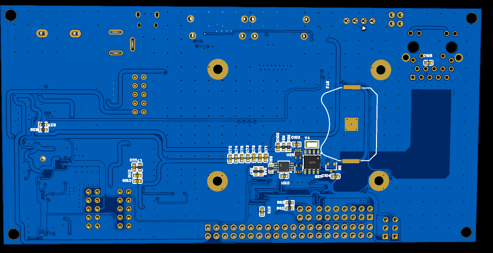

## Overview  
  
In this directory there will be brief explanation and screen shot of CM4 IO
  
## Design Goal 
This project are intended as a replacement for the current custom Raspberry pi HAT that the client use for internet connected fish scale. The main reason to use CM4 is  the flexibility to layout what connector as it needed ,yet with this flexibility are there one main issue which are layouting which require careful planning and execution since it's uses high speed digital data that require very specific way to route them.

## Design Approach 

## PCB Screenshots  (PCM5102)

  
  

